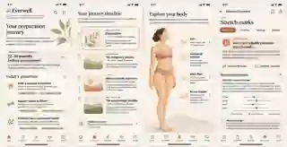

# Optional design avenue — Everwell concept, 2026-11-26

The user liked ChatGPT's four-screen visual concept and wants Claude to develop its own design independently. Everwell is a working name, not final branding. Treat this as inspiration only; Claude may improve or replace the palette, layouts, typography and name. No UI implementation, clinical visual approval or architecture choice is implied.

## Visual language
Warm ivory paper, muted sage/eucalyptus, terracotta/clay accents, near-black text, elegant editorial serif headings and legible sans-serif body copy. Premium botanical field-guide character, restrained cards, tactile illustrations, thin dividers, distinct screen layouts. Example optional tokens: ivory #F7F2E9, ink #242722, sage #738568, clay #B65E38, border #DBD2C4. Actual colors must be contrast-tested. Provide accessible light/dark modes if feasible.

## Four-screen concept
1. **Today**: app title, adjustable preparation phase (sample 12–18 months before conception, not a personal timeline), three current priorities, optional bookmarks/search, bottom navigation.
2. **Timeline**: visual preconception, pregnancy, birth and postpartum sections, adjustable time horizon and optional focus settings. Phases are organizational bands, not clinical deadlines.
3. **Explore**: respectful stylized anatomical body map with selectable skin, abdominal function, pelvic floor and breast topics; equivalent accessible list. No body scoring, idealized shape goals or compulsory tracking.
4. **Research**: a stretch-marks example with quick takeaway, evidence and separate safety/uncertainty, expandable methods, real source-linked effect estimates and source tabs. Generated concept chart is illustrative only; discard its dummy trial labels and visual evidence ratings for production. No clinical claims or graphic anatomy from the mockup should be imported without review.
Bottom tabs: Home, Timeline, Explore, Research, Library (optional structure).

## App experience
See [platform requirements](../PLATFORM_REQUIREMENTS.md): iPhone first, Home Screen launch mandatory, responsive tablet/Android/desktop access. Claude owns architecture and final visual decisions. The original generated collage is an image in the chat; this document captures its direction independently of chat history. A compressed 320-pixel thumbnail of the actual generated image is stored below; the original full-resolution file remains in the chat.

## Reference
[Editable schematic recreation](everwell-concept.svg) — a compact approximation of the four-screen concept, not the original generated image or final product.

The thumbnail preserves the original overall visual direction but is not suitable for reading small UI text. Use the written concept and SVG for details.
